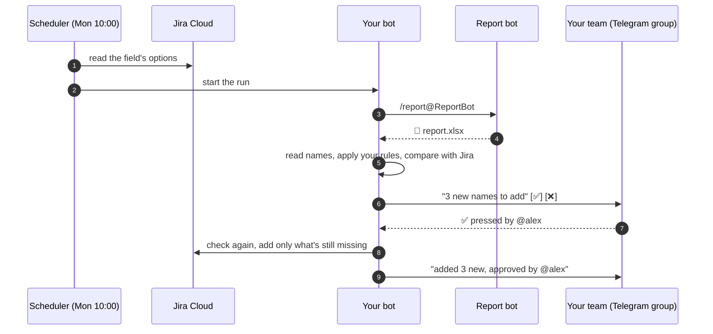

<div align="center">

# jira-dropdown-sync

**Keep a Jira dropdown in sync with the list your Telegram bot already knows, with a human ✅ before anything changes.**


</div>

---

Your team has a Jira select-list field (**Merchant**, **Client**, **Partner**, …) and a reporting bot in a Telegram group that knows the real, current list. Every week someone compares the two and adds the missing options by hand.

**jira-dropdown-sync** does that for you. Once a week it asks the bot for its Excel report, works out which names Jira doesn't have yet, lets the group approve them with one tap, and adds them. It **never deletes, renames or reorders** anything.

```text
Mon 10:00   🤖 SyncBot     /report@ReportBot
            🤖 ReportBot   📎 Merchant report_2026-11-09.xlsx
            🤖 SyncBot     Jira "Merchant" field: 3 new names to add
                           • Nova Bet ACME
                           • Orbit Group
                           • Lumen Pay ACME

                           Anyone here can decide. Waiting until 18:00.
                           [ ✅ Add them ]   [ ❌ Don't add ]
Mon 10:42   👤 Alex taps ✅
            🤖 SyncBot     Jira "Merchant" field: added 3 new, approved by @alex
```

## ✨ Features

- **🤝 Bot-to-bot.** Your bot asks the report bot directly, using Telegram's bot-to-bot communication (Bot API 10). No user account, no scraping.
- **✅ Human in the loop.** New names are posted with ✅ / ❌ buttons, and Jira only changes after a tap. You can switch this off for fully automatic runs.
- **➕ Only adds.** It reads the field and adds missing options in one request. It never deletes, renames, reorders, enables or disables an option, and never touches tickets or other fields. A test checks that.
- **🧠 Smart matching.** Upper/lowercase, extra spaces and words you choose (your company tag, `Ltd`, `LLC`, …) never make a name "new". Variant markers can be dropped, so `Nova PROMO` merges into `Nova`.
- **🗂️ Big groups stay one option.** For groups you list, only the group's name goes into Jira, not one option per merchant in it.
- **🔍 Strict with the report.** Columns are found by their header and the rows are checked against the `Total — N` row. A damaged file is rejected. If anything looks wrong, nothing is added and the group is told why.
- **🛡️ Hard to break.** It waits out network drops, Telegram hiccups and a sleeping PC. Reads are retried, writes never are. Only one run happens at a time, and buttons are never left pressable when a run ends.
- **🪶 Zero infrastructure.** One Python script plus Windows Task Scheduler or cron. No server, no webhook, no database.

## ⚙️ How it works



Jira is read **before** the bot is asked, so a broken Jira token never makes your bot spam the group.

## 🚀 Quick start

1. **Python 3.12+**
   ```bash
   pip install -r requirements.txt
   ```
2. **Create your bot** with [@BotFather](https://t.me/BotFather):
   - turn **Bot-to-Bot Communication Mode on**;
   - turn **Group Privacy off** *before* adding the bot to a group (the setting only applies on join);
   - add the bot to the group where the report bot lives.
3. **Jira:** create an [API token](https://id.atlassian.com/manage-profile/security/api-tokens) for an account that is a **Jira admin**, because editing a field's options needs admin rights.
4. **Configure:**
   ```bash
   cp .env.example .env    # then fill it in
   ```
5. **Check silently.** This only reads Jira and doesn't use Telegram:
   ```bash
   python merchant_sync.py --dry-run --file "report.xlsx"
   ```
6. **Run it for real:**
   ```bash
   python merchant_sync.py
   ```
7. **Schedule it** (see [Scheduling](#-scheduling)).

> **Group id?** Add your bot to the group, write any message there, then open
> `https://api.telegram.org/bot<TOKEN>/getUpdates` and look for `"chat":{"id":-100…}`.

## 🔧 Configuration

Everything lives in `.env`. Key names aren't case-sensitive.

| Key | Required | What it is | Example |
|---|:---:|---|---|
| `TELEGRAM_BOT_TOKEN` | ✅ | Your bot's token from @BotFather | `123456:ABC…` |
| `REPORT_BOT` | ✅ | The bot that answers with the Excel (with or without `@`) | `ReportBot` |
| `REPORT_COMMAND` | ✅ | The command your bot writes; it's sent as `/command@REPORT_BOT` | `/report` |
| `TELEGRAM_GROUP_ID` | ✅ | The group both bots are in | `-1001234567890` |
| `JIRA_URL` | ✅ | Your Jira Cloud site (must be `https://`) | `https://acme.atlassian.net` |
| `JIRA_EMAIL` | ✅ | The Jira admin account's email | `ops@acme.com` |
| `JIRA_API_TOKEN` | ✅ | That account's API token | |
| `JIRA_FIELD` | | Exact name of the select-list custom field | `Merchant` (default) |
| `BY_CONFIRMATION` | | Ask in the group before adding | `True` (default) |
| `REPORT_FILE_PREFIX` | | Only take files whose name starts with this | *(empty: any `.xlsx`)* |
| `MERCHANT_COLUMN` / `GROUP_COLUMN` | | Column headers in the Excel | `Merchant` / `Group` (default) |
| `DROP_WORDS` | | Words removed from merchant names, comma-separated | `PROMO` |
| `IGNORE_WORDS` | | Words that don't make two names different, comma-separated | `ACME, Ltd, LLC` |
| `GROUPS_WITHOUT_MERCHANTS` | | Groups added as the group name only, without their merchants, comma-separated | `Orbit Group, Zenith Group` |
| `CHECK_TOTAL_ROW` | | Rows must match a `Total — N` row under the table | `True` (default) |

## 🧠 Name rules

With `DROP_WORDS=PROMO` and `IGNORE_WORDS=ACME`:

| In the report | Added to Jira as | Why |
|---|---|---|
| `Nova Bet ACME` | `Nova Bet ACME` | kept exactly as written |
| `Nova Bet ACME PROMO` | *(same as above)* | `PROMO` is dropped, so it merges with its base merchant |
| `Blue Harbor ACME` | *(nothing)* | Jira already has `Blue Harbor`: `ACME` doesn't make it new |
| `NOVA BET acme` | *(nothing)* | upper/lowercase never makes a name new |
| `Vega Play` and `Vega Play ACME` | `Vega Play ACME` | same name, so it's added once, using the spelling with the ignore word |
| Group `— no group —` | *(nothing)* | placeholders and empty cells are skipped |

- Groups are used exactly as written (only placeholders are skipped).
- A **disabled** option in Jira counts as already there, so it isn't re-added or re-enabled.
- Words are matched as whole words: `ACME` never matches inside `ACMEPay`.

### Groups without their merchants

With `GROUPS_WITHOUT_MERCHANTS=Orbit Group`, a big group becomes one option instead of one per merchant:

| In the report (merchant, group) | Added to Jira as | Why |
|---|---|---|
| `Nova Bet ACME`, `Orbit Group` | `Orbit Group` | only the group's name, its merchants are skipped |
| `Orbit Pay ACME`, `— no group —` | `Orbit Pay ACME` | the Group column decides who is in a group, not the name |

- A listed group matches like any other name (upper/lowercase, spaces and `IGNORE_WORDS` don't matter), but it must be the whole group name: `Orbit` doesn't match `Orbit Group`.
- If a listed group isn't in the report (a typo, or the group was renamed), the run logs a warning.
- Merchants of a listed group that are already in Jira stay there. It only stops new ones from being added.

## ✅ Confirmation mode

With `BY_CONFIRMATION=True` (the default):

- **✅ Add them:** the buttons disappear at once. Jira is checked again, in case someone added a name by hand while waiting, and the rest are added.
- **❌ Don't add:** nothing is added. The names are offered again next week.
- **Nobody answers by 18:00:** nothing is added, and the buttons are removed. The wait is always at least 1 hour and never more than 11 hours.
- **A list too long for one message:** it doesn't ask, because nobody can approve names they can't see.
- **The run crashes or is stopped:** the question is turned into a short note, so its buttons don't stay live.
- **A press on an old list** gets the reply *"This list is old"* and changes nothing.

With `BY_CONFIRMATION=False`, names are added straight away and the group is told what was added. A **25-name limit** protects the field in that mode: anything bigger needs a run with `--no-limit`.

## 🖥️ Commands

```bash
python merchant_sync.py                            # the weekly run
python merchant_sync.py --dry-run                  # what would be added; Jira untouched, no note posted
python merchant_sync.py --dry-run --file X.xlsx    # completely silent check on a saved report
python merchant_sync.py --file X.xlsx              # use a saved report instead of asking the bot
python merchant_sync.py --no-limit                 # allow more than 25 new names (automatic mode)
```

`--dry-run` without `--file` still writes the command in the group to get a fresh report.

| Exit code | Meaning |
|:---:|---|
| `0` | Done |
| `1` | Needs attention: a failure, the limit was hit, or nobody answered |
| `2` | `.env` is incomplete |
| `3` | Another run is still going, for example one waiting for a button press |

Every run is logged to `logs/merchant_sync.log`.

## 🗓️ Scheduling

**Windows (Task Scheduler)**, every Monday at 10:00. The task catches up if the PC was off, waits for the network, never runs twice, and is allowed 12 hours:

```powershell
$dir = "C:\path\to\jira-dropdown-sync"
$action   = New-ScheduledTaskAction -Execute "pyw.exe" -Argument "merchant_sync.py" -WorkingDirectory $dir
$trigger  = New-ScheduledTaskTrigger -Weekly -DaysOfWeek Monday -At 10:00
$settings = New-ScheduledTaskSettingsSet -StartWhenAvailable -RunOnlyIfNetworkAvailable `
            -ExecutionTimeLimit (New-TimeSpan -Hours 12) -MultipleInstances IgnoreNew
Register-ScheduledTask -TaskName "jira-dropdown-sync sync" -Action $action -Trigger $trigger -Settings $settings
```

**Prefer a batch file?** Point the task at `run.bat` instead. It starts from its own folder, finds Python even when the task doesn't have it on its PATH, and hands back the exit code, so *Last Run Result* shows the codes listed under Commands:

```powershell
$action = New-ScheduledTaskAction -Execute "$dir\run.bat" -WorkingDirectory $dir
```

Unlike `pyw.exe`, it opens a console window that stays until the run ends (in confirmation mode, until someone answers). Minimize it instead of closing it, or pick *Run whether user is logged on or not* so no window opens.

**Linux / macOS (cron):**

```cron
0 10 * * 1  cd /opt/jira-dropdown-sync && python3 merchant_sync.py
```

The code is plain Python and is tested on Windows.

## 🧪 Tests

```bash
python -m pytest
```

There are 154 tests, and they run in about 2 seconds. Telegram and Jira are replaced by in-memory fakes that answer the real API paths with the real JSON shapes, so the tests never send anything.

## 📁 Project layout

```text
merchant_sync.py   the run: settings, comparing, confirmation, notes, CLI
names.py           reading the Excel and the name rules
jira_field.py      reading and adding the field's options (GET + POST only)
telegram_bot.py    asking the report bot, buttons, waiting, downloading
run.bat            starts the run from its own folder, for Task Scheduler
tests/             unit and end-to-end tests against fake Telegram and Jira
```

## 🔐 Security notes

- Secrets live only in `.env`, which is git-ignored.
- The bot token is scrubbed from every error message and log line.
- With Group Privacy off, anyone with your bot token can read the group. If it leaks, send `/revoke` to @BotFather.
- Atlassian API tokens expire (at most after a year). When that happens, the weekly note says Jira refused the token.

## 📄 License

[MIT](LICENSE)
